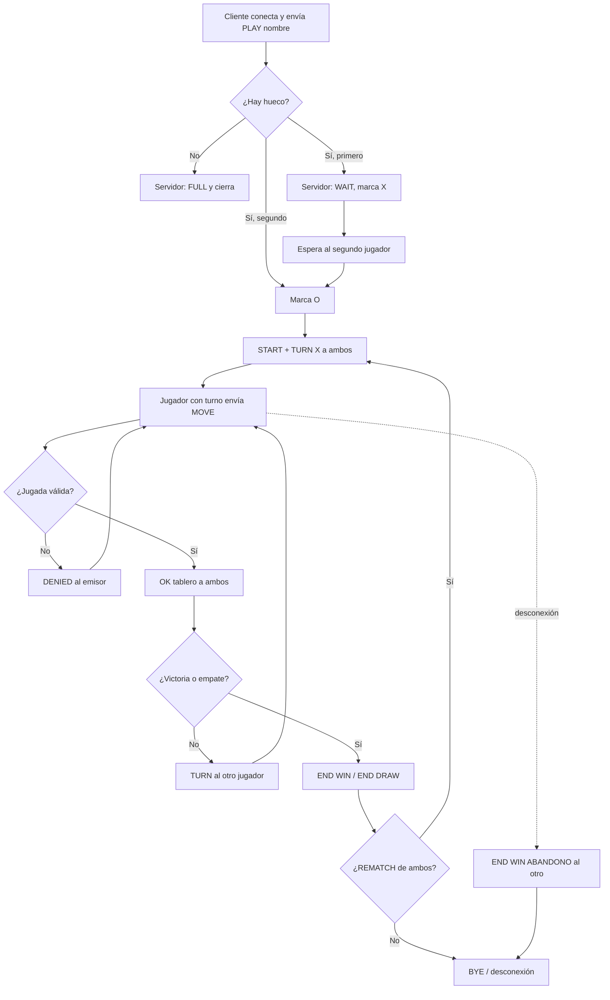

# Tres en raya online (Java, TCP)

Sistema cliente-servidor para jugar al tres en raya entre dos clientes remotos conectados por TCP.
El servidor actúa como árbitro: espera a los dos jugadores, valida las jugadas, controla los turnos y declara el resultado.

## Versiones

| Componente | Versión |
|---|---|
| Java (JDK) | **21** (Temurin 21, el configurado en el proyecto IntelliJ) |
| JavaFX | **21** (SDK 21.x, módulo `javafx.controls`) |

JavaFX no viene incluido en el JDK, hay que descargarlo aparte (ver más abajo).
Solo se usa `javafx.controls`; no hace falta FXML ni otros módulos.

## Contenido

```
TresEnRaya/
├── src/
│   ├── Server.java      Servidor (árbitro de la partida)
│   ├── Client.java      Cliente de consola
│   └── ClientFX.java    Cliente gráfico JavaFX con historial revisable
├── scripts/             Compilar y ejecutar (.sh para Linux/macOS, .bat para Windows)
└── README.md
```

## Requisitos

1. JDK 21.
2. JavaFX SDK 21 de https://gluonhq.com/products/javafx (solo para `ClientFX`).
   Descomprímelo y apunta la variable `JAVAFX_HOME` a su carpeta, por ejemplo:
   - Linux/macOS: `export JAVAFX_HOME=~/javafx-sdk-21.0.x`
   - Windows: `set JAVAFX_HOME=C:\javafx-sdk-21.0.x`

## Compilar y ejecutar

Desde la raíz del proyecto:

| Acción | Linux / macOS | Windows |
|---|---|---|
| Compilar | `scripts/compilar.sh` | `scripts\compilar.bat` |
| Servidor (puerto 5050) | `scripts/servidor.sh [puerto]` | `scripts\servidor.bat [puerto]` |
| Cliente gráfico | `scripts/cliente-fx.sh` | `scripts\cliente-fx.bat` |
| Cliente consola | `scripts/cliente-consola.sh [host] [puerto] [nombre]` | `scripts\cliente-consola.bat [host] [puerto] [nombre]` |

Para jugar: arranca el servidor y luego dos clientes. En la demo entre máquinas distintas, el servidor corre en una
y cada cliente pone en su ventana la IP de esa máquina (puerto 5050 abierto en el cortafuegos).

### En IntelliJ IDEA

1. *File → Project Structure → Libraries → + → Java* y elige la carpeta `lib` del SDK de JavaFX 21.
2. Crea una configuración *Application* con clase principal `ClientFX` y en *VM options*:
   `--module-path "<ruta>/javafx-sdk-21.0.x/lib" --add-modules javafx.controls`
3. Activa *Allow multiple instances* para abrir dos clientes desde el IDE.
4. `Server` y `Client` se ejecutan sin ninguna opción especial.

## Protocolo de comunicación

Protocolo textual, un mensaje por línea, codificación UTF-8.

| Comando | Emisor | Descripción |
|---|---|---|
| `PLAY <nombre>` | Cliente | Pide entrar a la partida. Debe ser el primer mensaje (15 s de margen). |
| `FULL` | Servidor | La partida ya tiene dos jugadores; conexión rechazada y cerrada. |
| `WAIT` | Servidor | Falta el segundo jugador; quedas en espera. También confirma que tu petición de revancha está pendiente. |
| `START <X\|O> <rival>` | Servidor | Empieza la partida; te toca esa marca y se indica el nombre del rival. |
| `TURN <X\|O>` | Servidor | Indica a ambos de quién es el turno. |
| `MOVE <fila,col>` | Cliente | Quiere marcar esa casilla (fila y columna de 1 a 3). |
| `OK <tablero>` | Servidor | Movimiento aceptado. Tablero de 9 caracteres por filas (`X`, `O`, `.` vacía), p. ej. `X.O..X...`. Se envía a ambos. |
| `DENIED <motivo>` | Servidor | Movimiento inválido (no es tu turno, casilla ocupada, fuera del tablero, formato incorrecto, partida terminada). |
| `END WIN <marca> <nombre>` | Servidor | Fin con victoria. |
| `END DRAW` | Servidor | Fin con empate. |
| `END WIN <marca> <nombre> ABANDONO` | Servidor | El rival se desconectó a mitad de partida. |
| `REMATCH` | Cliente / Servidor | El cliente pide revancha; el servidor se lo reenvía al rival para avisarle. |
| `BYE` | Cliente | Desconexión voluntaria. |
| `LEFT` | Servidor | El rival se fue tras acabar la partida. |
| `ERROR <texto>` | Servidor | Mensaje inválido (comando desconocido, `PLAY` mal formado). |

### Ampliaciones respecto a la propuesta del enunciado

- `START` incluye el nombre del rival, para mostrarlo en la interfaz.
- `END WIN` lleva la marca y el nombre del ganador; el sufijo `ABANDONO` distingue la victoria por abandono.
- `LEFT` y `ERROR` son nuevos: avisan de que el rival se ha ido tras el final y de errores de protocolo.
- `WAIT` se reutiliza para indicar «esperando a que el rival acepte la revancha».

## Mecánica de la partida

1. El primer jugador en conectarse recibe la marca X y `WAIT`.
2. Al llegar el segundo (O), ambos reciben `START` y `TURN X`.
3. Un tercer cliente recibe `FULL` y se le cierra la conexión.
4. El servidor solo acepta `MOVE` del jugador que tiene el turno; valida el formato, el rango y que la casilla esté libre.
5. Tras cada jugada válida envía `OK <tablero>` a los dos y comprueba victoria (8 líneas) o empate (tablero lleno).
6. Al terminar, ambos reciben `END` y pueden pedir `REMATCH` (si los dos aceptan, se intercambian las marcas y empieza quien era O) o salir.
7. Si un jugador se desconecta a mitad de partida, el otro recibe `END WIN ... ABANDONO`.
8. Cuando se van los dos, la sala queda libre para una nueva partida.

## Diagrama de flujo de una partida



## Decisiones de diseño

- **Un hilo por cliente en el servidor** (`ClientHandler`). Mientras un hilo está bloqueado en `readLine`, el otro jugador sigue siendo atendido.
- **Estado de la partida compartido y protegido con `synchronized`.** `entrar`, `procesar` y `salir` son métodos estáticos sincronizados sobre `Server`, de modo que dos jugadas simultáneas, dos conexiones a la vez o una desconexión durante una jugada se serializan. La lectura bloqueante del socket queda fuera del cerrojo. `enviar` está sincronizado por jugador, y el orden de cerrojos es siempre el mismo (sin interbloqueos).
- **El servidor es la única autoridad.** El cliente no valida nada de la partida: envía `MOVE` y pinta lo que devuelve el servidor.
- **El tablero viaja completo en cada `OK`.** Simplifica la sincronización: los dos clientes siempre pintan el mismo estado, sin acumular diferencias.
- **Cliente JavaFX con dos hilos.** Un hilo lee del socket y pasa cada línea a la interfaz con `Platform.runLater`, porque solo el hilo de JavaFX puede modificar los controles.
- **Historial en el cliente.** Cada `OK` ya contiene el tablero completo, así que el cliente guarda cada uno en una lista (`START` la vacía en cada revancha). Al llegar `END` se activa un panel con `<` y `>` para revisar la partida jugada a jugada, mostrando qué casilla se jugó, y el historial se guarda también en `historial_<nombre>.txt`. No se necesita ningún mensaje nuevo ni cambios en el servidor.
- **Robustez:** `PLAY` obligatorio en 15 s, nombres normalizados (sin espacios, máx. 20 caracteres), comandos desconocidos respondidos con `ERROR`, y el `finally` del hilo siempre libera al jugador y cierra el socket.

## Manejo de errores y cierre de recursos

- Cliente caído o `BYE`: el servidor lo trata igual (`salir`), avisa al rival y cierra el socket.
- Abandono en partida: `END WIN ... ABANDONO` al que queda.
- Abandono tras el final: `LEFT` al que queda.
- Servidor no disponible: el cliente muestra el error de conexión.
- Cierre de la ventana JavaFX: envía `BYE`, cierra el socket y termina la aplicación.

## Limitaciones conocidas

- Una sola partida a la vez por servidor.
- Si un jugador abandona, el que queda no recibe un rival nuevo hasta que salga y vuelva a conectarse.
- El historial vive en el cliente: si se cierra la ventana se pierde de la memoria, aunque queda el fichero `historial_<nombre>.txt`.
